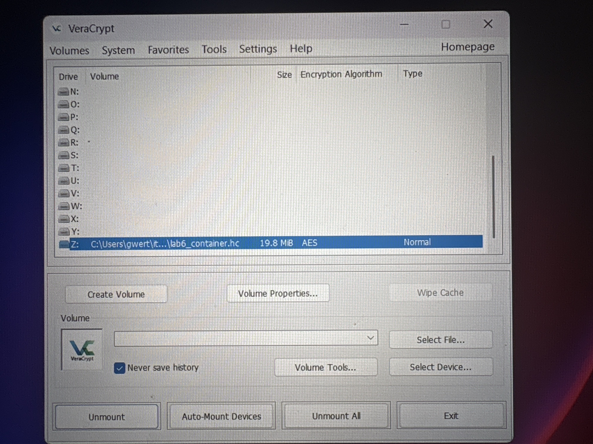
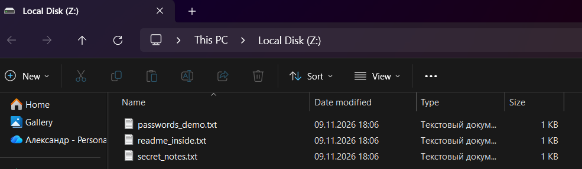

# Отчёт по лабораторной работе №6

**Федеральное государственное автономное образовательное учреждение высшего образования «Национальный исследовательский университет ИТМО»**

Дисциплина: «Информационная безопасность»
Работа 6: Криптография на практике: шифрование файлов и сообщений
ФИО: Чураков А. А.
Номер группы: P3431
Год: 2026

---

## Цель работы

Получить практический опыт использования **симметричного** (шифрование файлов в
контейнере VeraCrypt) и **асимметричного** (PGP-ключи) шифрования.

---

## 1. Симметричное шифрование — VeraCrypt

### 1.1. Установка

VeraCrypt 1.26.x установлен на Windows 11 через пакетный менеджер:

```
winget install --id IDRIX.VeraCrypt -e
```

### 1.2. Создание зашифрованного контейнера

Создан файловый контейнер **`lab6_container.hc`** размером 20 МБ. Параметры тома:

| Параметр | Значение |
|---|---|
| Тип | Файловый контейнер (стандартный том) |
| Алгоритм шифрования | **AES** (256 бит, режим XTS) |
| Алгоритм хэширования | **SHA-512** |
| Файловая система | FAT |
| Защита | пароль (мастер-ключ выводится из пароля функцией PBKDF2) |

После создания том смонтирован как виртуальный диск (буква **Z:**), и в него
скопированы учебные файлы (`secret_notes.txt`, `passwords_demo.txt`,
`readme_inside.txt`). Пока том смонтирован, с файлами можно работать как с обычным
диском; после размонтирования (Dismount) данные снова доступны только в виде
зашифрованного файла-контейнера.

> **Важно:** пока диск Z: смонтирован, данные расшифровываются «на лету» (on-the-fly)
> в оперативной памяти — на физическом диске они всегда остаются зашифрованными.



*Скриншот 1 — интерфейс VeraCrypt: том `lab6_container.hc` смонтирован на букву Z: (AES, тип Normal)*



*Скриншот 2 — файлы внутри смонтированного зашифрованного тома (диск Z:)*

### 1.3. Как это работает

Симметричное шифрование означает, что **один и тот же ключ** используется и для
зашифрования, и для расшифрования. VeraCrypt не хранит ключ отдельно: из введённого
пароля (и соли, хранящейся в заголовке тома) функцией формирования ключа **PBKDF2**
многократным хэшированием выводится мастер-ключ, которым AES шифрует каждый сектор
контейнера. Без пароля заголовок невозможно расшифровать, а значит — и получить
мастер-ключ, поэтому содержимое контейнера нечитаемо.

---

## 2. Асимметричное шифрование — PGP

### 2.1. Генерация пары ключей

Пара ключей сгенерирована с помощью **GnuPG 2.4** (реализация стандарта OpenPGP):

```
gpg --full-generate-key     # тип RSA, 3072 бита, срок действия 1 год
```

Параметры созданной пары:

| Параметр | Значение |
|---|---|
| Владелец (UID) | Churakov A. A. &lt;awesoma3110@gmail.com&gt; |
| Алгоритм | RSA 3072 бит |
| Отпечаток (fingerprint) | `77B1 4271 FC54 240C 36B4  519B 83FD FDA9 A543 EC71` |
| Срок действия | 1 год |

Пара состоит из **закрытого (private)** ключа — хранится в секрете и защищён
парольной фразой — и **открытого (public)** ключа, который можно свободно
передавать другим.

### 2.2. Экспорт открытого ключа

Открытый ключ экспортирован в ASCII-формат (файл [`public_key.asc`](public_key.asc)):

```
gpg --armor --export awesoma3110@gmail.com > public_key.asc
```

### 2.3. Как это работает

В асимметричной схеме ключи разные: то, что зашифровано **открытым** ключом
получателя, расшифровать можно только парным **закрытым** ключом. Поэтому открытый
ключ можно публиковать: отправитель берёт открытый ключ получателя, шифрует им
сообщение, и прочитать его сможет только владелец закрытого ключа. Обратная операция —
подпись: автор подписывает сообщение закрытым ключом, а любой может проверить подпись
его открытым ключом (подтверждение авторства и целостности).

На практике PGP использует **гибридную** схему: само сообщение шифруется быстрым
симметричным алгоритмом (сеансовый ключ), а асимметрично шифруется только короткий
сеансовый ключ — так совмещаются скорость симметричного и удобство обмена ключами
асимметричного шифрования.

---

## 3. Разница между симметричным и асимметричным шифрованием

| Критерий | Симметричное (VeraCrypt / AES) | Асимметричное (PGP / RSA) |
|---|---|---|
| Количество ключей | Один общий секретный ключ | Пара: открытый + закрытый |
| Кто чем шифрует/расшифровывает | Один ключ для обеих операций | Шифруют открытым, расшифровывают закрытым |
| Скорость | Высокая, подходит для больших объёмов данных | В сотни раз медленнее, для больших данных неудобно |
| Проблема передачи ключа | Ключ нужно передать по защищённому каналу | Открытый ключ передаётся свободно, секретный не передаётся вовсе |
| Типичное применение | Шифрование дисков, файлов, баз данных | Обмен ключами, цифровая подпись, шифрование писем |

**Главное отличие:** в симметричном шифровании безопасность держится на секретности
единственного ключа, который обе стороны должны как-то безопасно согласовать;
в асимметричном — на математической связи пары ключей, что снимает проблему передачи
секрета: открытый ключ можно отдавать кому угодно.

---

## Вывод

На практике применены оба класса шифрования. Симметричным (VeraCrypt, AES-256 в режиме
XTS) создан защищённый паролем контейнер, смонтированный как виртуальный диск, — данные
на нём шифруются и расшифровываются «на лету». Асимметричным (PGP, RSA-3072) сгенерирована
пара ключей и экспортирован открытый ключ для передачи другим. Показана принципиальная
разница подходов: симметричное шифрование быстрое, но требует безопасной передачи общего
ключа, тогда как асимметричное решает проблему обмена ключами за счёт пары
открытый/закрытый.

## Содержимое папки

- `README.md` — настоящий отчёт
- `public_key.asc` — экспортированный открытый PGP-ключ (деливерабл)
- `screenshots/` — скриншоты VeraCrypt и gpg
- `payload/` — учебные файлы, помещённые в зашифрованный контейнер
